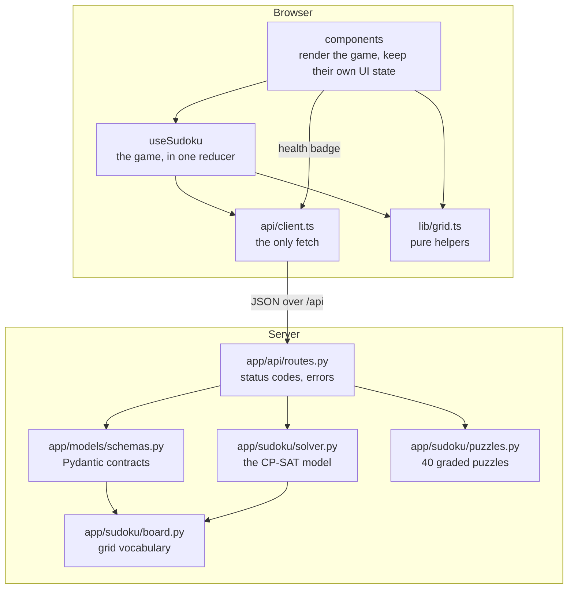
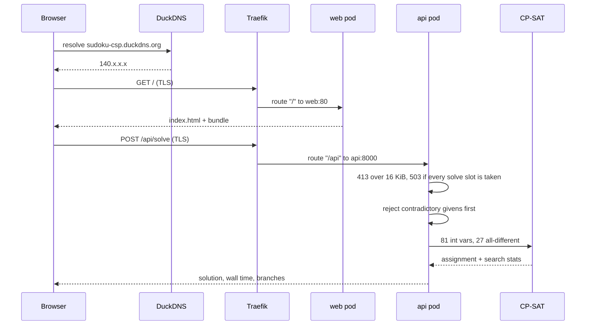
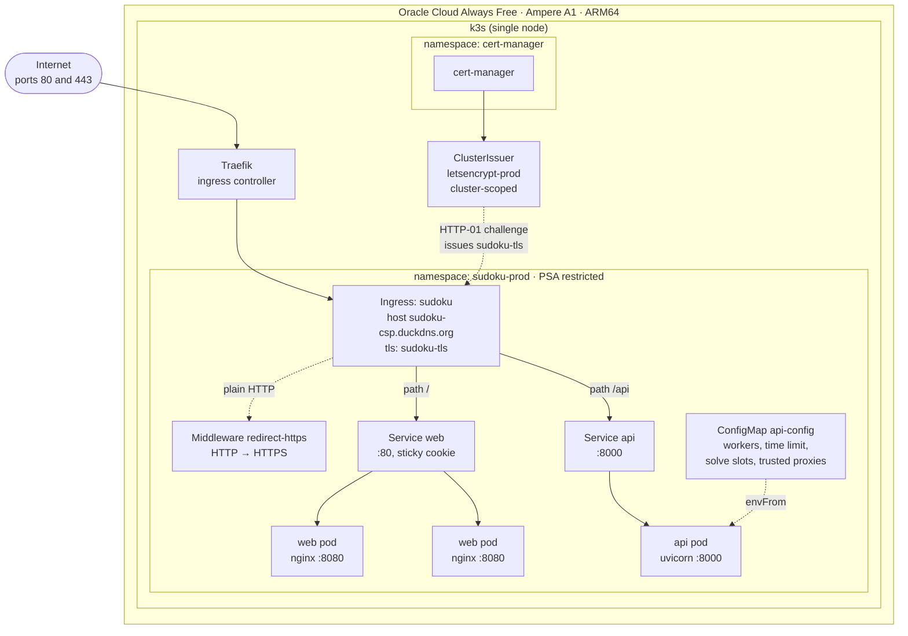
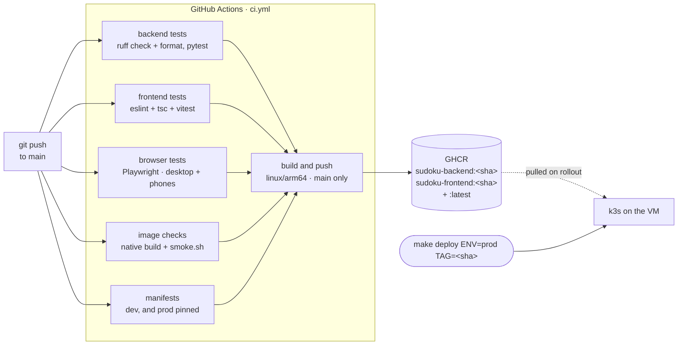

# Architecture

How the Sudoku solver is built, shipped and hosted — and why every line of the
hosting bill is zero.

Live at **[sudoku-csp.duckdns.org](https://sudoku-csp.duckdns.org/)**, running
on one Oracle Cloud Always Free ARM VM.

---

## The shape of it

Three pieces, each with one job:

| Piece | Job | Runs as |
|---|---|---|
| Solver | State Sudoku as 27 all-different constraints, hand it to CP-SAT | Python module, no HTTP |
| API | Translate JSON to grids and back, own the status codes | FastAPI on uvicorn |
| Board | Let a person type a puzzle and watch it solve | React SPA served by nginx |

The dependency arrows only ever point one way. `app/sudoku/` knows nothing about
FastAPI and runs on its own — `python -m app.sudoku.solver` solves a puzzle per
level with no server involved. The front end mirrors it: `lib/grid.ts` is pure,
`api/client.ts` is the only module that calls `fetch`, and `hooks/useSudoku.ts`
owns the game: the board, the moves, the solution and the conflicts live in
one `useReducer`, so each change is worked out from the state as it is, and
`pending` says which request is out (`'load'`, `'solve'` or `'check'`).
Components keep only what is theirs: `SudokuGrid` the selected cell, the one
Tab stop and the number pad's announcement, and the header's API badge its
own health check, which it asks the client for itself.



A grid is always a 9×9 array of integers with `0` for an empty cell, in every
layer and over the wire. The 81-character string form is an input convenience,
not a second model.

---

## How a request is served

One origin, always. The browser never makes a cross-origin request, so CORS
never enters into it — in development the Vite dev server proxies `/api` to
uvicorn, and in production the ingress splits the paths. Same contract, two
mechanisms.



Three details worth knowing. Contradictory givens are caught *before* the
solver runs, and every cell of the repeat is listed, so the API can say
`r1c5=6 repeats in its row` instead of shrugging with "no solution". The solve
handlers are plain `def`, not `async def` — CP-SAT is blocking CPU work, and
FastAPI runs sync handlers in a worker thread instead of stalling the event
loop — and only `SUDOKU_SOLVER_CONCURRENCY` of them may solve at once. One
more is answered with a 503 and `Retry-After: 1` straight away, since a queue
behind CP-SAT would only grow until everything in it timed out. `/api/health`
is `async` and needs no thread, so the probes are answered however busy the
solver is.

And the browser does not wait forever either. The client gives up on a
request after 65 s, a little over the longest solve the server can be set to
allow, and turns every failure into one line for the status bar: the API's
own `detail` when there is one, a "try again shortly" for a proxy's 502, 503
or 504, and a plain "cannot reach the solver API" when the network is gone.
The controls go `aria-disabled` rather than disabled while a request is out,
so keyboard focus stays where the player left it. A failed start is not final
either: when the levels do not load, the picker offers Retry and the hook tries
again by itself once the browser is back online, and the API badge asks
`/api/health` again when the network returns, when the page comes back into
view, and every 15 s while the API is down.

---

## What runs on the VM

A single-node k3s cluster. k3s bundles Traefik as its ingress controller, so
there is nothing to install for routing; cert-manager is the one addition.



### Why the ingress splits the paths

Everything could enter through the web pod, which already proxies `/api` onward
for the compose setup. Splitting at the ingress instead means the API scales
independently of the static server and there is no extra hop — and the browser
still sees one origin either way.

### Why the web pod is the one with two replicas

The solver is the expensive half and the node is small, so `api` runs one
replica with room to use it. The static server costs 25 millicores, so it runs
two, and the site stays up while one of them crashes or is evicted. Rollouts
need no second replica: under the default rolling update the new pod is
started and Ready before the old one stops, which is how the single `api`
replica rolls without a gap too.

| Workload | Replicas | CPU request → limit | Memory request → limit |
|---|---|---|---|
| `api` | 1 | 200m → 1 | 256Mi → 640Mi |
| `web` | 2 | 25m → 200m | 32Mi → 128Mi |

`SUDOKU_SOLVER_WORKERS` is set to **1**. On a 9×9 board CP-SAT's parallel
portfolio only adds thread start-up and contention, and one thread is what the
pod's one-CPU limit can run anyway. `SUDOKU_SOLVER_CONCURRENCY` is set to
**2**: two solves share that CPU, and a third gets a 503. It has to be set,
because its default counts the CPUs the process may be scheduled on, which in
a pod is every core on the node; the CPU limit does not change that.

The VM's cores are shared with k3s, Traefik and cert-manager, so the `api`
asks for a fifth of one and may use one whole. A long solve is held to it
rather than starving the node.

### Hardening

Both images set a numeric non-root `USER`; the pods add the rest in their
`securityContext`: `runAsNonRoot`, a read-only root filesystem, no privilege
escalation, every capability dropped and the `RuntimeDefault` seccomp profile.
That is the `restricted` Pod Security profile, and both namespaces enforce it,
so a change that needs more fails at admission rather than going unnoticed.
Neither pod mounts a service account token or gets Service links in its
environment: nothing in them talks to the Kubernetes API.

A read-only root means the writable paths have to be declared:

- `api` gets an `emptyDir` at `/tmp`
- `web` gets three — `/etc/nginx/conf.d` (the entrypoint renders its config
  template into it at startup), `/var/cache/nginx`, and `/run` for the pid file

That last one has to be `/run`, not the `/var/run` symlink that points at it.
Mounting the symlink's path replaces it with a directory and nginx then writes
its pid to a read-only root. `compose.yaml` runs both images under the same
constraints, with `tmpfs` mounts in the same places, so a write to somewhere
new fails under `make up` before it fails in a pod.

nginx adds its share at the edge: no version in the `Server` header,
`nosniff`, a `strict-origin-when-cross-origin` Referrer-Policy and HSTS on
every response, and a Content-Security-Policy on the SPA's HTML that allows
nothing from anywhere else. uvicorn believes `X-Forwarded-For` and `-Proto`
only from the pod network (`FORWARDED_ALLOW_IPS=10.42.0.0/16`), where Traefik
runs, and Traefik replaces those headers on anything that arrives from
outside.

---

## How code gets there

No image is pushed *to* the VM. The VM pulls: `make deploy` hands the cluster
a spec that names a commit, and the cluster reaches out to GHCR over 443 for
that build.



**A red test never reaches the registry.** The build job declares
`needs: [backend, frontend, e2e, images, manifests]`, so it does not start
until every suite passes, the browser tests included, and both images have
been built natively and smoke-tested and both overlays rendered. Its
condition is `github.ref == 'refs/heads/main' && github.event_name !=
'pull_request'`: pull requests run every check and publish nothing, and so
does a manual run from any other branch.

**The pipeline keeps its own house in order.** The workflow token is
`contents: read`, and only the build job adds `packages: write`. A
concurrency group per ref cancels a pull request's superseded run and queues
runs on `main`, so its builds land in commit order. Every action is pinned to
a commit, every checkout drops its credentials, every job has a timeout, and
Dependabot proposes new action commits and base-image digests once a month.

**Images must be `linux/arm64`.** The free Ampere VM is ARM; an amd64 image
crash-loops there with `exec format error`. The backend sits on
`python:3.13-slim` rather than Alpine so the OR-Tools aarch64 wheel installs as
a binary instead of trying to compile. The frontend's Node stage is pinned to
`$BUILDPLATFORM`, so the bundle is built natively on the x86 runner and only
the small nginx stage is emulated. Every base image is pinned by digest, and
the backend installs from a hash-checked lock file, as wheels only, building
nothing, so two builds of one commit are the same image.

**Prod runs a commit, never a mutable tag.** CI pushes each build of `main` as
`:<commit sha>` and `:latest`, and nothing deploys `:latest`. The prod
overlay's tag is a placeholder, `set-by-make-deploy`; the rollout is a
command, run once CI is green:

```bash
make deploy ENV=prod TAG=<full commit sha>
```

`deploy/k8s/render.sh` swaps the commit in on a scratch copy of `deploy/k8s`,
refuses anything but a full 40-character SHA, and checks that both images
took it. The applied spec then records which build is live, a restarted
container comes back on the same build, and the pods pull `IfNotPresent`,
since a commit tag never changes. Going back is the same command with an
older SHA. The overlay applied as it stands names an image that does not
exist, so a stray `kubectl apply -k` leaves the new pods in `ErrImagePull`
while the old ones keep serving.

**A rollout keeps each page on one build.** Each web pod can only serve the hashed
assets of its own build. `index.html` is sent with `Cache-Control: no-cache`,
so a browser revalidates it on every load instead of keeping one whose assets
are gone, while `/assets/` stays cached for a year. During a rollout both
builds serve at once, so the prod web Service carries a Traefik sticky
cookie, and a browser's asset requests go to the pod its `index.html` came
from. Each pod also sleeps 5 s before it stops, so Traefik has taken it out
of rotation by then.

---

## The cost

Every component sits inside a tier that is free indefinitely, not a trial and
not a credit that expires.

| Component | Provider | Tier | Cost |
|---|---|---|---|
| Compute — the whole cluster | Oracle Cloud | Always Free Ampere A1 | **$0** |
| Block storage | Oracle Cloud | Always Free boot volume | **$0** |
| Kubernetes | k3s | Open source, self-hosted | **$0** |
| Ingress controller | Traefik | Bundled with k3s | **$0** |
| Container registry | GitHub Container Registry | Free for public packages | **$0** |
| CI minutes | GitHub Actions | Unlimited for public repositories | **$0** |
| Hostname | DuckDNS | Free subdomain | **$0** |
| TLS certificate | Let's Encrypt via cert-manager | Free, auto-renewing | **$0** |
| | | **Total** | **$0 / month** |

### What makes each one actually free

- **Oracle's Ampere allocation is "Always Free"**, not a 30-day trial. It is
  the only tier generous enough to run a real cluster — which is why the
  ARM constraint runs through every build decision in this repo.
- **The repository is public**, so GHCR packages can be public and Actions
  minutes are unmetered. That is also why no `imagePullSecrets` appears
  anywhere in `deploy/k8s` — an anonymous pull is all the cluster needs.
- **The app is stateless.** No database, no PVC, no backups. The puzzle library
  is a Python module and a solve holds nothing between requests. A Postgres
  StatefulSet would have meant a persistent volume and a real operational
  burden for a solver that has nothing to persist.
- **cert-manager renews on its own**, so TLS never becomes a recurring task or
  a recurring charge.

### What would start costing money

- A managed control plane. GKE covers one zonal control plane on its free tier
  but not the worker nodes; AKS and EKS bill the nodes too.
- Outgrowing Oracle's egress allowance, which a solver serving a 250 KB
  bundle, under 80 KB gzipped, is in no danger of.
- Making the repository private — GHCR would then need a pull secret and
  Actions minutes would be metered.
- Adding a database. This is the change that would end the zero-cost story
  fastest, and the reason the app has stayed stateless.

---

## What is deliberately not here

- **No GitOps.** A push builds images; a human runs
  `make deploy ENV=prod TAG=<sha>`. Argo CD or Flux would close that loop, and
  both would still be free.
- **No request queue.** A solve over the concurrency limit gets a 503 and
  `Retry-After: 1` rather than waiting its turn. On one small node a queue
  only turns a burst into a pile of timeouts.
- **No horizontal autoscaler, no pod disruption budget.** One node makes both
  of them theatre.
- **No observability stack.** `kubectl logs` and `kubectl get events` are the
  whole toolkit. Prometheus and Grafana would fit the free RAM budget, but
  nothing here has needed them yet.

---

## Where to look next

| Question | File |
|---|---|
| How the constraints are stated | [`backend/app/sudoku/solver.py`](backend/app/sudoku/solver.py) |
| What the API promises | [`backend/app/models/schemas.py`](backend/app/models/schemas.py) |
| What differs per environment | [`deploy/k8s/overlays/`](deploy/k8s/overlays/) |
| How images get built | [`.github/workflows/ci.yml`](.github/workflows/ci.yml) |
| How to stand this up yourself | [README — One-time setup](README.md#one-time-setup) |
